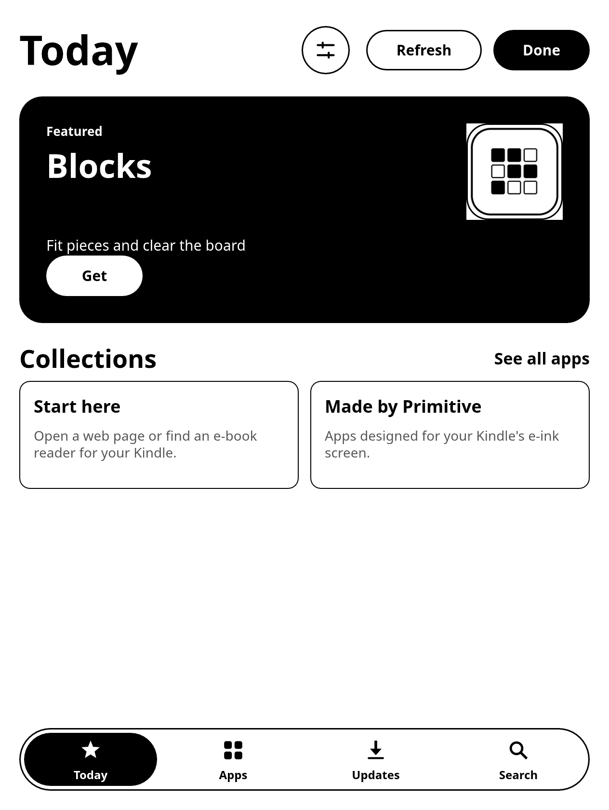
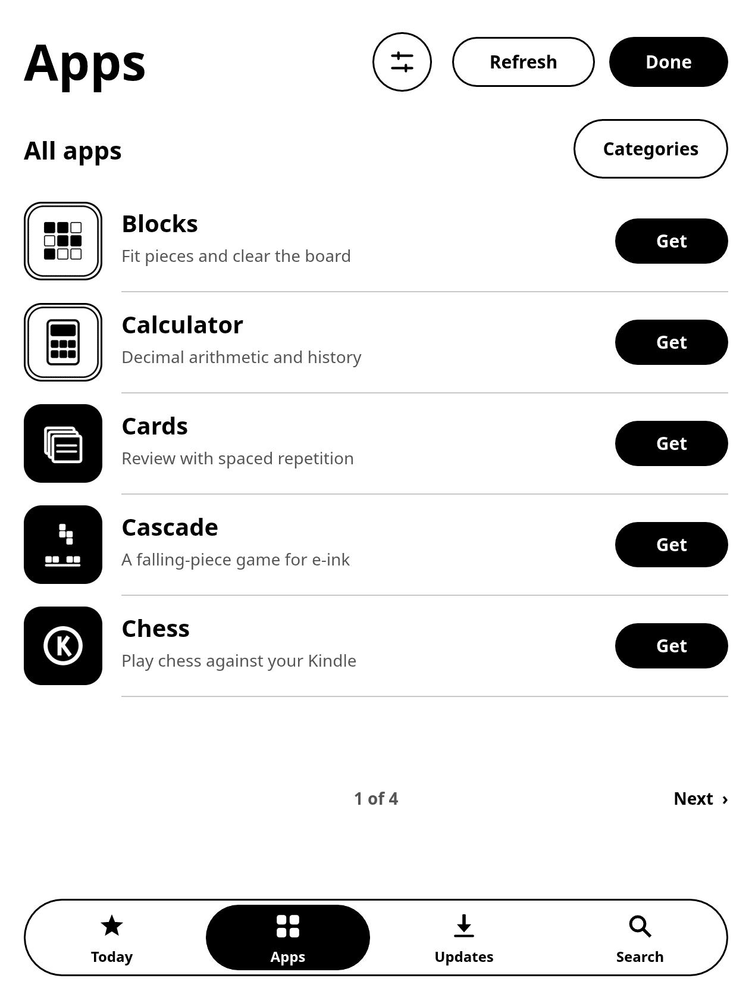
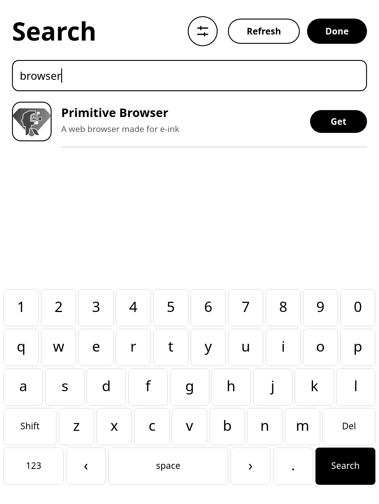
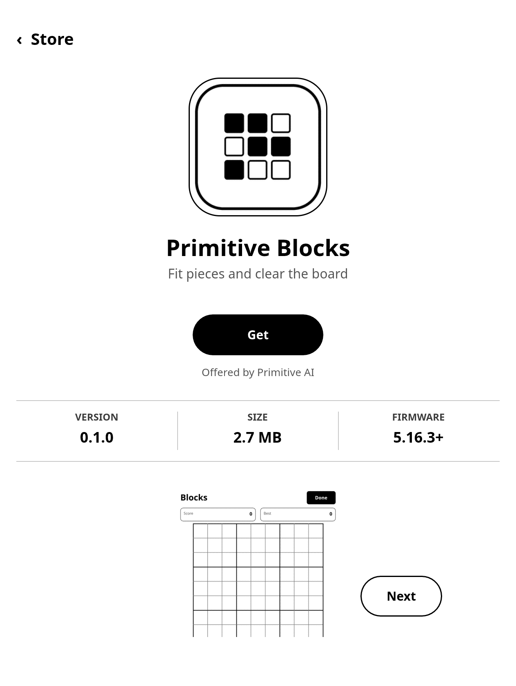
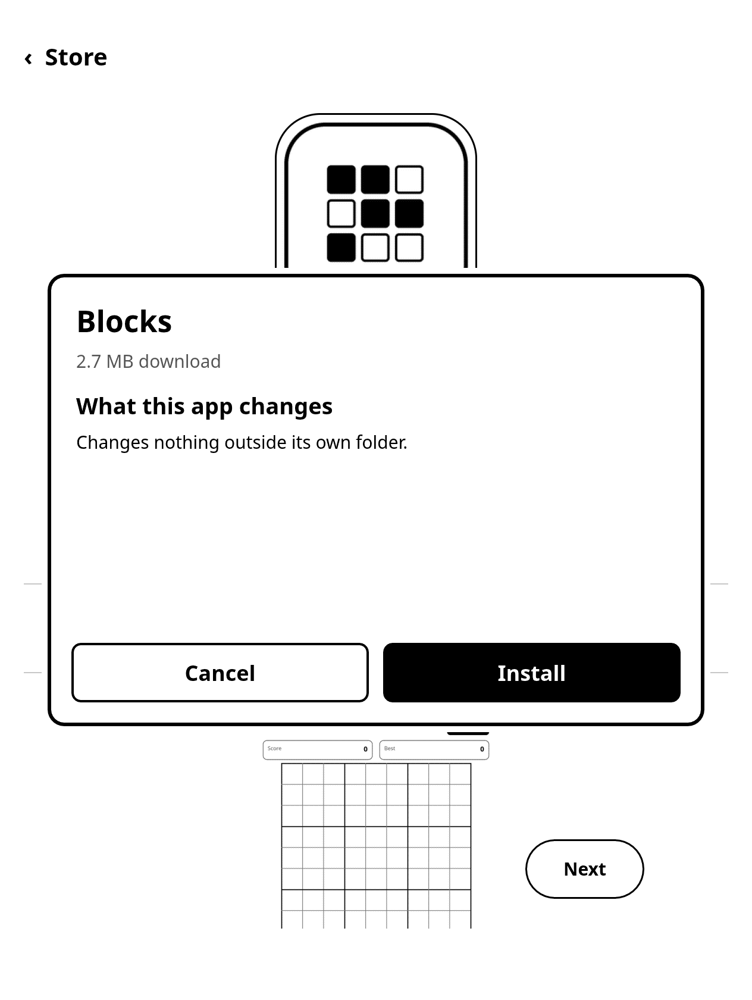
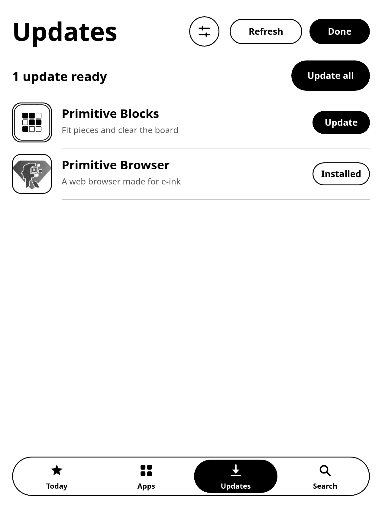

<div align="center">

# Store

**Find and manage PrimitiveOS apps on your Kindle.**

[**Install guide**](INSTALL.md) · [**Changelog**](CHANGELOG.md) · [**Licence**](#licence)

</div>

---

Store brings Today, Apps, Updates, and Search to the Kindle in a grayscale interface. Open an app page to
see the version, download size, firmware requirements, screenshots, and what it changes before you install.
The Store is a standalone Rust application that uses Primitive Launcher's fonts and settings.

## Screenshots

<table>
  <tr>
    <td align="center"><br><sub>Featured apps and collections</sub></td>
    <td align="center"><br><sub>Browse the catalogue</sub></td>
    <td align="center"><br><sub>Find an app by name</sub></td>
  </tr>
  <tr>
    <td align="center"><br><sub>Read an app's details</sub></td>
    <td align="center"><br><sub>Review changes before installing</sub></td>
    <td align="center"><br><sub>See what can be updated</sub></td>
  </tr>
</table>

<sub>Captured from the macOS desktop preview with a private review catalogue and sample install states.</sub>

## Highlights

- **Browse offline.** The Store saves the catalogue so you can browse it after a refresh without Wi-Fi.
- **See refresh progress.** Store shows how many listings it has checked. Tap **Done** to stop a refresh and
  return to Launcher.
- **Check every download.** The Store verifies the archive size and SHA-256. An optional trusted key enables Ed25519
  verification for the catalogue and packages.
- **Manage installed apps.** Open, update, and remove supported apps from their product pages. The Store keeps a
  record of installed files and uses it to recover interrupted changes.

## Quick start

After setting up PrimitiveOS with Primitive Launcher, open **Store** from the Launcher grid and follow the
installation prompt if it appears. Tap **Refresh** to fetch the catalogue. [Install guide](INSTALL.md)

Launcher’s **Settings › Apps › Installed apps** shortcut opens the **Updates** tab directly on compatible builds.
The tab shows installed apps even when the saved catalogue has been cleared.

The Store saves its catalogue and install records in `/mnt/us/launcher/store/`.

## Status

Store 0.1.2 refreshed the live catalogue and installed ARMHF apps over Wi-Fi on a Kindle Oasis 3 running
firmware 5.18.2. The package declares firmware 5.16.3 or later.

<details>
<summary><b>Build and test from source</b></summary>

Use Rust, Zig, cargo-zigbuild, and the shared packager checked out as `../doannt-kindle-build`.

```sh
git submodule update --init --recursive
cargo test --locked --workspace
cargo zigbuild --locked --release -p store-app --target armv7-unknown-linux-musleabihf
sh scripts/stage.sh armhf
python3 ../doannt-kindle-build/scripts/package.py --id primitive-store --dir store \
  --version 0.1.3 --arch armhf --stage build/stage --license LICENSE \
  --docs-license LICENSE-DOCS --install INSTALL.md --out dist
```

The program lives in `crates/store-app`. The shared screen, device, networking, and installer code lives in
`tools/`. The library entry and SSH installer live in `deploy/`.

</details>

## Licence

Copyright (C) 2026 Doan Nguyen.

- **Code** is licensed under PolyForm Noncommercial 1.0.0. [Software licence](LICENSE)
- **Original documentation and pictures**, including this README and its screenshots, are licensed under
  CC BY-NC-SA 4.0. [Documentation and pictures licence](LICENSE-DOCS)
- **Shared Tools** is available under AGPL-3.0 or PolyForm Noncommercial 1.0.0. [Shared Tools](tools/)
